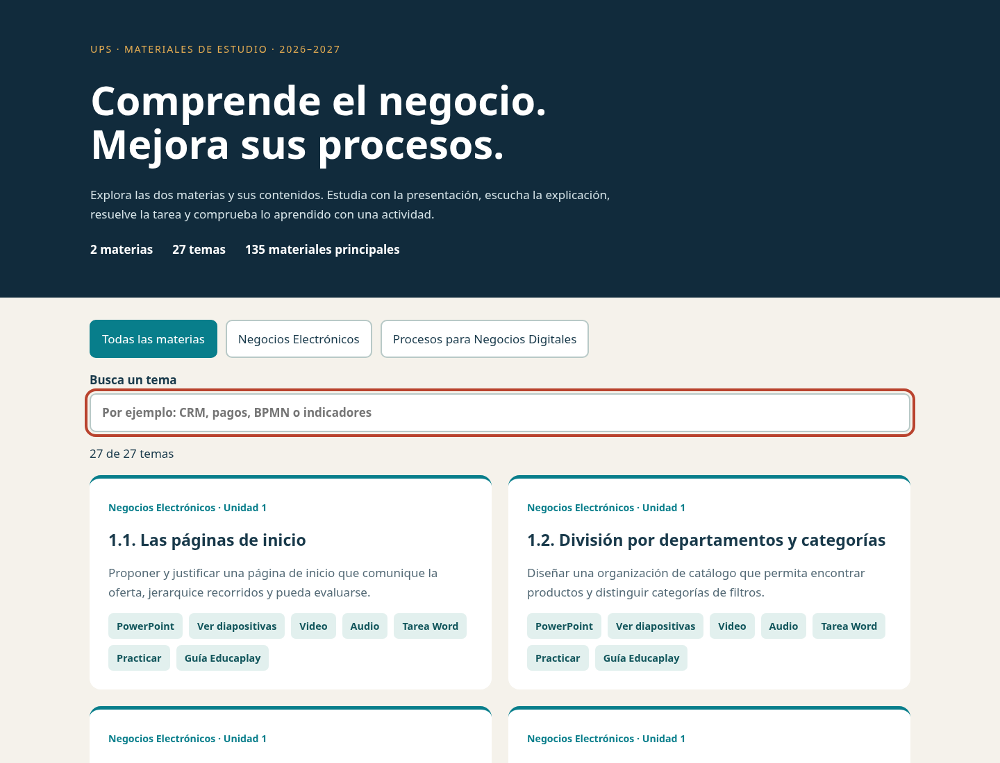

# aporte · proyecto educativo completo

**27 temas de dos materias · 135 entregables principales · 270 diapositivas · 218 preguntas.**

Colección basada en los sílabos de Negocios Electrónicos y Procesos para Negocios Digitales de la Universidad Politécnica Salesiana, período 2026–2027. Están desarrollados los doce subtemas de la primera materia y los quince de la segunda.

## Acceso a los materiales

- [Guía completa del proyecto](Proyecto_Educativo/README.md)
- [Catálogo HTML](Proyecto_Educativo/index.html): descarga el repositorio, extrae el ZIP y abre este archivo para navegar por los temas.
- [Matriz curricular PDF](Proyecto_Educativo/Matriz_temas.pdf)
- [Validación de documentos, medios y actividades](Proyecto_Educativo/Validacion.md)
- [Negocios Electrónicos](Proyecto_Educativo/Negocios_Electronicos/)
- [Procesos para Negocios Digitales](Proyecto_Educativo/Procesos_para_Negocios_Digitales/)
- [Descargar el repositorio completo como ZIP](https://github.com/jeshuapapo-lab/aporte/archive/refs/heads/main.zip)

Cada tema incluye PowerPoint editable, video MP4 de dos a cuatro minutos, audio MP3 independiente, tarea Word y actividad preparada para Educaplay. Hay versiones PDF, prácticas HTML, guiones, bancos de preguntas, modelos BPMN y datos simulados de apoyo.

Las actividades de Educaplay contienen todo lo necesario para publicarlas desde una cuenta autorizada; no se han publicado ni se inventan enlaces. Los medios usan voz neuronal con fonetización latinoamericana. Los casos y datos son ficticios. Los documentos se abrieron con LibreOffice y los medios y actividades se probaron en Chromium y FFmpeg.

El proyecto educativo está dentro de Proyecto_Educativo/. El archivo del sitio anterior se conserva; no se afirma una publicación de este catálogo en GitHub Pages. Los modelos de voz y cachés no forman parte del repositorio.
